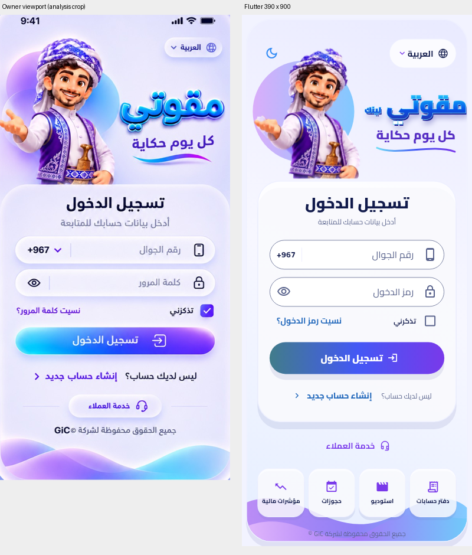

# تقرير المطابقة البصرية — 2026-11-23

**المطابقة الدقيقة غير معتمدة**. وصل مرجع المالك الحقيقي، وحُفظ دون تعديل في [approved_login_owner_20261122.jpg](design_reference/approved_login_owner_20261122.jpg)، أبعاده 861×1280 وSHA256: `7c133ab74b73d04c762f3ed5596716a721784d1932748026ec3885cc53f91485`.

اليسرى قص تقريبي لمنطقة العرض للتحليل فقط؛ الأصل محفوظ كاملاً. اليمنى التقاط Flutter فعلي، وليست تركيباً فوق التصميم. اختلاف الأبعاد ونظام التشغيل والخط يمنع اعتبار مقارنة بكسلات مباشرة أو SSIM دليلاً صالحاً للمطابقة. لم يُخترع قياس أو تصريح قبول.

## التعديلات المبنية على المرجع

الشخصية في اليسار واللغة في اليمين، رفع حجم الترويسة وموازنتها، تكبير عنوان الدخول، حقول مستديرة مع +967 ظاهر باتجاه LTR، تذكرني في اليمين والاستعادة في اليسار، إنشاء الحساب في سطر واحد، والموجة أسفل الشاشة. اختيار العربية يفتح قائمة فعلية بالعربية المتاحة فقط. تبديل النهار/الليل فعلي. تذكرني قابل للنقر على النص والمربع.

لم تُغير ملامح أو أزياء الشخصيات، ولم يُولد بديل. الـPNG الحالي هو الأصل المتاح لكنه منخفض الدقة. أزرار المعاينة غير ظاهرة في شاشة الدخول النهائية.

## الفروق المتبقية والمقصودة

| الفرق | السبب/الحالة |
|---|---|
| رسم الاسم ثلاثي الأبعاد غير مطابق للرسم الفني | التنفيذ Text/Shader، ولا يتوفر شعار مستقل أصلي؛ يحتاج الأصل المعتمد |
| الاسم الكامل «مقوتي لينك» مقابل «مقوتي» في الصورة | حفظ النص الصريح المطلوب في التكليف |
| رمز دخول 4 أرقام مقابل عبارة كلمة المرور | حفظ آلية المصادقة الموجودة، دون تغييرها لإصلاح المظهر |
| الأيقونات التعريفية الأربع وزر الوضع | إلزاميان في التكليف ولو غابا من الصورة المرسلة |
| تدرج CTA أغمق من السماوي اللامع | حفظ تباين النص الأبيض ≥4.5:1؛ تدرجات الزينة الأصلية محفوظة |
| لا هاتف مزيف أو ساعة iOS 9:41 | Android يرسم عناصر النظام الحقيقية |
| الشخصية أقل حدة وحوافها محدودة | المصدر نحو 170×200px؛ أصل شفاف معتمد ≥750px ارتفاعاً مطلوب |
| الشفافية والوهج والموجات تقريب بصري | لم تتحقق مطابقة فنية دقيقة أو موافقة نهائية من المالك |

## مراجعة بقية الواجهات

جرت مراجعة صور **34 حالة** في الثيمات الأربعة عند 390dp، مع Golden آلي للعروض الستة. صور البداية: [أزرق نهاري](ui_evidence/phase2-blue_day-screens.png)، [أزرق ليلي](ui_evidence/phase2-blue_night-screens.png)، [وردي نهاري](ui_evidence/phase2-pink_day-screens.png)، [وردي ليلي](ui_evidence/phase2-pink_night-screens.png). صور نهاية التمرير بجوارها بأسماء `phase2-*-scroll-end.png`؛ الصور المفردة في `test/ui_audit/goldens`، ولا تكفي contact sheet صغيرة للحكم على كل حرف.

المراجعة كشفت وأصلحت قص بطاقات العملات، تداخل المبلغ مع مؤشر التحصيل، عدم الوصول لتقرير الحركة، قص فرز العملاء، سطر جمهور التنبيهات، وقص شبكة ملخص حساب العميل وحالات الموافقات مع الخط الكبير. لا اعتماد بصري شامل لكل تفاعل إنتاجي.

## دليل قبل/بعد وحدوده

- `ui_evidence/before/`: 24 صورة دخول من الأساس 4bbaba1 التقطت منفصلة بعد موافقة المالك، دون اختصار اختبارات القبول في الفرع.
- [مقارنة الدخول الأولى](ui_evidence/login-before-after.png): سجل تاريخي؛ المقارنة الأحدث مع مرجع المالك أعلى هذا التقرير.
- `ui_evidence/phase2_before/`: 112 صورة من c12c7b8 (24 دخول + 88 حالة عند 390dp)، وسجل `phase2-before-regression.log`: 592 PASS و60 FAIL قبل الإصلاحات.
- 12 فشلاً إضافياً كشفها التمرير، و12 فشلاً كشفتها الحالات المالية الممتلئة أُصلحت. هذه أعداد حالات فشل متكررة عبر الثيمات، وليست 84 عيباً مستقلاً.
- الحالات المالية الممتلئة السبع أُضيفت لاحقاً؛ لا صور «قبل» مكافئة لها. مقارنة شاشة مقفلة بشاشة ممتلئة لا تثبت تحسن نفس البيانات.
- صور Android المثبتة لـ4c1e15d في `ui_evidence/android_4c1e15d/`. النسخة الأحدث97607e5 اجتازت تشغيل45099036723 كما في الأدلة النهائية أدناه.

الأصل JPEG التالف مؤرشف كما هو في `legacy_corrupt_mascot.jpeg.bin` خارج assets. الفحص الجنائي استعاد صورة 1254×1254 ذات **هوية خضراء قديمة** في `recovered_legacy_green_not_for_app.jpg`؛ لا تُستخدم في التطبيق ولا تحل مشكلة دقة الأصل المعتمد. البانرات التسويقية وحدها مستثناة بموافقة المالك من شرط جنس الشخصية.

## تقوية دليل الصور قبل الالتقاط

مراجعة contact sheet كشفت خمس لقطات بداية سبقت فك PNG (دخول أزرق320، ورئيسية التاجر والتسجيل أزرق/وردي320). نجاح Golden كان يقارن الصورة الناقصة بنفسها؛ لا نعتبره دليلاً سليماً لظهور الشخصية. أضيف image_audit.dart لانتظار فك **كل صورة مرئية** والتأكيد على وجود frame في RawImage قبل المقارنة، دون إخفاء أي خطأ أصل. أُعيد توليد الصور الخمس فقط بعد هذا التأكيد، ثم أعيد الاختبار دون update-goldens. [مصفوفة الدخول الحالية](ui_evidence/current-login-matrix.png) تظهر الشخصية عند320 أيضاً. لا يغيّر هذا كود التطبيق أو الأصول.

[فهرس قبل/بعد لكل ملفات الشاشات العشرة المعدلة](ui_evidence/SCREEN_BEFORE_AFTER_INDEX.md): 40 زوج صورة عند390dp، مع تحديد commit وحالة كل دليل والقيود.

## مراجعة Android الحالية

Actions45099036723 عند97607e5 ناجح بالكامل. [مصفوفة الدخول الأصلية من APK](ui_evidence/android_97607e5/phone-matrix.png)، وصور المطورين: [أزرق نهاري](ui_evidence/android_97607e5/developer-blue_day.png)، [أزرق ليلي](ui_evidence/android_97607e5/developer-blue_night.png)، [وردي نهاري](ui_evidence/android_97607e5/developer-pink_day.png)، [وردي ليلي](ui_evidence/android_97607e5/developer-pink_night.png).

119 صورة فُكت، منها13 حالة تنقل/نافذة لكل ثيم عند390dp. روجعت هذه المصفوفات وصور الحقول/IME والمنع دون مصادقة بالحجم الكامل. الملفات الفردية وصور الأحجام الإضافية محفوظة؛ لا ادعاء تدقيق كل بكسل أو كل حالة إنتاجية. اللقطات الأولى قد تحتاج تمريراً لرؤية الخدمات/الحقوق كاملة؛ لا تضغط العناصر لتقليد صورة ثابتة. شريط دور المطورين ظاهر في حزمته المستقلة فقط، وليس الدخول النهائي.

نتيجة G7 تبقى NOT VERIFIED للمطابقة الفنية الأصلية رغم نجاح950Golden وAndroid: الخط والشعار المجسم والوهج والشفافية وجودة الأصول ليست مطابقة دقيقة للمرجع. لم تُنشأ نتيجةSSIM أو موافقة مالك غير موجودة.
