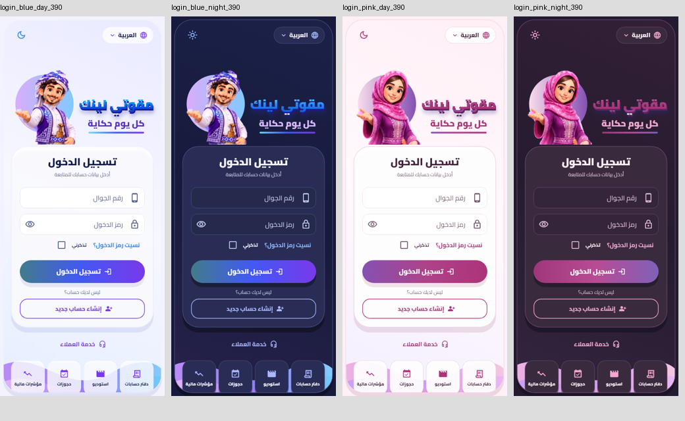
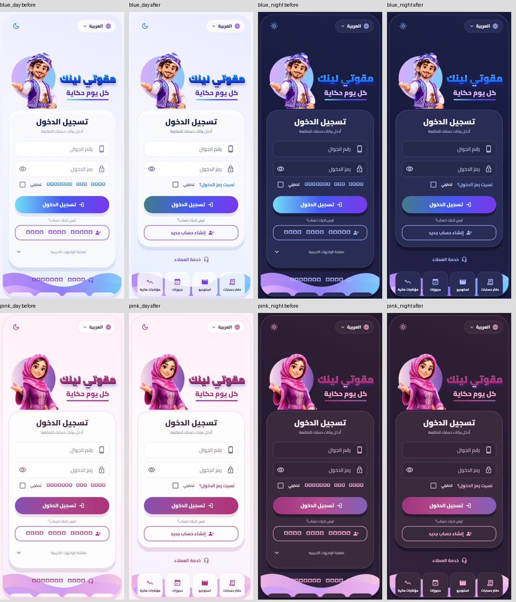

# تقرير المطابقة البصرية

**NOT VERIFIED للمطابقة المعتمدة**. المرجع الأصلي لشاشة المالك لم يوجد كملف مرجعي كامل قابل للمقارنة في هذا checkout؛ توجد وثائق تصفه وأصول شخصيات وبانرات. لم تُخترع صورة مرجعية أو موافقة.

المراجعة الفعلية: الشخصية المختارة صحيحة في الثيمات الأربعة، الاسم «مقوتي لينك» والشعار صحيحان، لا شريط دخول/تاجر/عميل، توجد مربعات الخدمات الأربعة صغيرة بالترتيب RTL. إصلاح تباين CTA ظاهر. الموجات موجودة. حقوق الشركة والحقول قابلة للوصول بالتمرير؛ اللقطة لا تعرض ما بعد حدود العرض كله.

الفروقات/الحدود: الشعار المجسم يحتاج تحسين وضوح ليلي، الشخصيات صغيرة المصدر وتظهر حدوداً لونية تحتاج أصل HD. اختيار اللغة عنصر غير موصول؛ لا ندعي دعماً لغوياً وظيفياً. الدعم والاستعادة وتسجيل الدخول غير موصولة بالخادم في هذا الفرع.

## قبل/بعد
- قبل: المصدر المثبت عند `4bbaba1` يستخدم JPEG تالفاً في الرئيسية والترويسة ويخفي فشله؛ تعطيل تكبير الخدمات؛ النص الثانوي الأفتح؛ CTA سماوي أبيض؛ معاينة مفعلة افتراضياً.
- بعد: التعديلات موصوفة في `UI_UX_COMPREHENSIVE_AUDIT.md` والـ diff؛ 24 صورة فعلية من Flutter tester و56 اختباراً.
- **التقطت 24 صورة قبل** من worktree عند `4bbaba1` بعد موافقة المستخدم الصريحة على الالتقاط المنفصل. قورنت بالصور الجديدة لنفس الثيمات والمقاسات، دون تعديل مصفوفة القبول. صور الأساس في `ui_evidence/before/`؛ أداة الالتقاط وسجلها محفوظان. هذه مقارنة تغييرات التنفيذ وليست مطابقة مرجع المالك.

مراجعة قبل/بعد: اختفاء قسم المعاينة من الدخول قلل طول النموذج، وتحسن وضوح زر الدخول والنص الثانوي. بعض نصوص أزرار الأساس تظهر مربعات في Flutter tester بسبب غياب family صريح في الأنماط القديمة؛ لا يُستنتج منها أن هاتف Android يعرض مربعات. لا تزال مشكلة الشعار الليلي ودقة الشخصيات قائمة.

## الأصول
PNG الرجل 168×200 وPNG الأنثى 172×199، RGBA وقابلان للفك؛ لم يولّد أي أصل جديد. الملف القديم `maqwati_approved_mascot.jpeg` غير صالح وما زال محفوظاً، لكن استُبدلت مراجعه في مكونات الواجهة المعدلة بملفات PNG. WebP قديم 157×160؛ البانرات السبعة تُفك بنجاح. التفاصيل في `ui_evidence/source_inventory.json`.

## المطلوب لإغلاق المطابقة
صورة المرجع الأصلية المعتمدة، نسخ الشخصيتين عالية الدقة معتمدة دون تغيير الملامح، مراجعة كل شاشة/حالة/ثيم ومقاس، ثم قبول Android. Golden الناجح لا يثبت هذه البنود.

## سجل دورة Golden
التشغيل الشامل الأول تزامن مع تحديث الخطوط/الأيقونات، فسجل 24 فرق Golden وتوقع لون ثانوي قديماً. بعد تحديث baselines وإصلاح توقع اللون، أُعيدت المجموعة بالكامل دون تحديث Golden: 328 PASS. ملفات `failures/` مخرجات فروق مؤقتة وليست صور «قبل» معتمدة؛ لا تُحفظ كأصول مرجعية ولا تُستخدم لإثبات مطابقة المالك.

## الجولة الثانية — مراجعة التاجر والعميل والمالية
صور فعلية من المكونات، لا تركيب تصميم فوق الشاشة:
- [الأزرق النهاري](ui_evidence/phase2-blue_day-screens.png)
- [الأزرق الليلي](ui_evidence/phase2-blue_night-screens.png)
- [الوردي النهاري](ui_evidence/phase2-pink_day-screens.png)
- [الوردي الليلي](ui_evidence/phase2-pink_night-screens.png)

اللقطات الفردية الأولية لجميع العروض الستة ونهايات التمرير في test/ui_audit/goldens. ملفات قبل الجولة الثانية (من c12c7b8) محفوظة في ui_evidence/phase2_before: 24 لقطة دخول سابقة و88 لقطة عند 390dp للشاشات/التبويبات الأولى. ليست كلها أحجاماً أو نوافذ؛ لا ادعاء بعكس ذلك. تشغيل المصفوفة نفسها على المصدر القديم: **592 PASS / 60 FAIL**، وسجله محفوظ. الوقت الحقيقي القديم مقابل الساعة المثبتة في الاختبارات الجديدة قد يغير تحية صباح/مساء؛ لا يُحسب ذلك فرق هوية.

المراجعة: تخطيط أكثر استقراراً مع الخط الكبير، ترويسات وبطاقات داكنة بالقدر اللازم للنص الأبيض، أدوات فرز ملتفة، ومؤشر التحصيل منفصل عن المبلغ. فحص التمرير كشف أخطاء لم تظهر في أول viewport وصُلحت. تحسن وضوح الشعار الليلي؛ دقة الأصل البشري المنخفضة لم تُخترع لها معالجة توليدية.

المستخدم أكد أن البانرات التسويقية المعتمدة مستثناة من قاعدة شخصيات الثيم. وأفاد بأنه سيرسل صورة التصميم الحقيقي؛ **المطابقة الأصلية تبقى NOT VERIFIED حتى وصولها ومقارنتها**.
