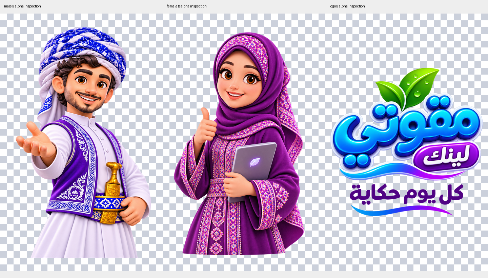

# صور مقوتي لينك المنفصلة عالية الدقة

تحديث الدمج: أذن المالك باستخدام الصور داخل التطبيق. المرأة والشعار من هذه المجموعة اعتُمدا، أما صورة الرجل هنا فهي مرشح سابق؛ اعتمدت بدلاً منها صورته المنفردة الأحدث ذات الجنبية المنحنية. المسارات والهاشات الحالية في [adopted_brand_assets_20261123.json](../adopted_brand_assets_20261123.json). تفاصيل مرحلة التوليد الأصلية أدناه سجل تاريخي، وليست الحالة الحالية للـruntime.

أنشئت بتوجيه المالك الصريح بالتوليد اعتماداً على صورته، وليست قصاً يحفظ بكسلات المصدر حرفياً. ملفات PNG مستقلة بخلفية alpha شفافة:

| الملف | الأبعاد | المحتوى |
|---|---|---|
| maqwati_male_hd.png |1024×1536| الرجل بالعمامة والثوب والصديري والجنبية |
| maqwati_female_hd.png |1024×1536| المرأة بالحجاب واللوح وإشارة الإعجاب، دون جنبية |
| maqwati_logo_hd.png |1254×1254| مقوتي لينك، كل يوم حكاية، والأوراق والموجة من المرجع |

الأصول المولدة نُسخت كما أعادتها الأداة؛ لم تُعدّل ألوانها أو بكسلاتها أو يُخترع تضخيم4K. فُك كل PNG، وتحقق alpha، وروجعت صورة التركيب على الخلفية الشبكية. الشبكة في alpha-review.png فقط وليست داخل الملفات الثلاثة. interiors أقصى alpha فيها254 للشخصيتين؛ لم ندّع عتامة255 أو قصاً حرفياً من المصدر.

الألوان الخضراء في ورقتي الشعار تفاصيل من المرجع، ولا تغيّر لوحة هوية التطبيق إلى الأخضر. التهجئة العربية راجعت بصرياً. لا يُعد هذا اعتماداً تلقائياً للملامح أو G4/G7، ولا صوراً مثبتة داخل APK. ملفات runtime الحالية ونتائج كود97607e5 لم تتغير. manifest.json يوثق المصدر والهاشات والأبعاد والشفافية.

